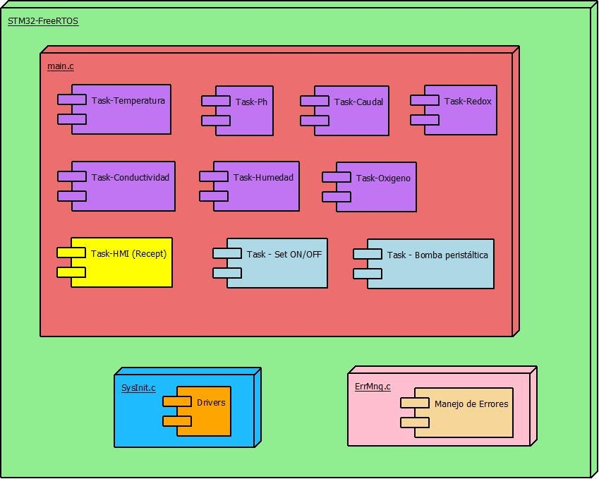

# FreeRTOS Project 

This Project represent an example of control of BioReactor, which needs to sense temperature, pressure, humidity, and activate
pumps, ON/OFF actuator and display through HMI screen.

In this example will use scheduler, queues, I2C and UART features.

Each task represents an transmission task (task used to sense), and reception task (HMI and task used to activate an actuator).

SysInit will initialize all the drivers (OsKernel, UART, GPIO, CLOCK and I2C) 

ErrMng will handle all errors (through error code), but this code has not been completed.

- *Block diagram*  

Each module (transmission task) receives the signal from sensor through I2C, then the data is sent through a queue to HMI task (reception task)
HMI receives through a queue all the data from all the modules, and with ID will identify which module is the owner.
Set ON/OFF and bomba (receptor task) will receive data from HMI and send control signal to actuators

- *HMI interaction*  

## Device

The deive used in this code example  (CE) is

- STM32F411

## Settings

STM32CubeIDE

## Run and Test

## References

https://stm32world.com/wiki/Black_Pill

