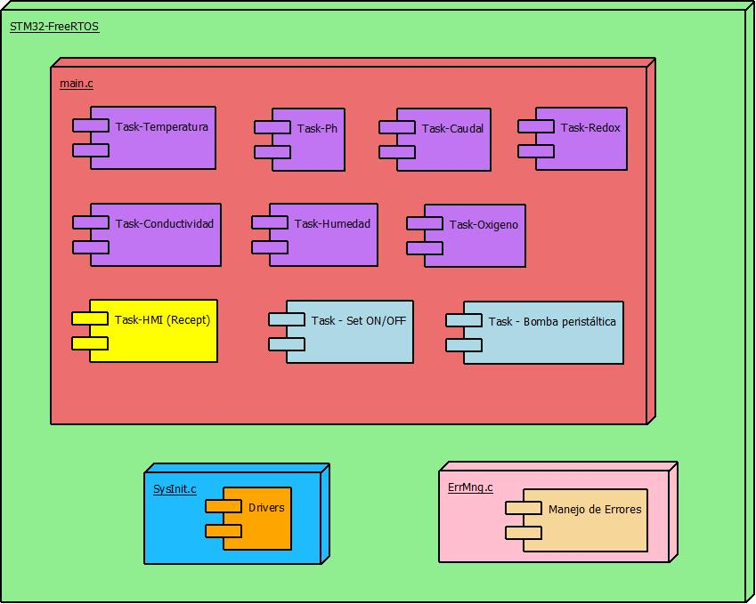

# FreeRTOS examples 

<<<<<<< HEAD
This code example shows how interact 3 tasks running with different priorities 
=======
This code example shows how 
>>>>>>> update v2

## Device

<<<<<<< HEAD
The device used in this code example  (CE) is
=======
The deive used in this code example  (CE) is
>>>>>>> update v2

- STM32F411

## Settings

STM32CubeIDE

<<<<<<< HEAD
=======
## Run and Test

- *Terminal output*  

>>>>>>> update v2
## References

https://stm32world.com/wiki/Black_Pill

